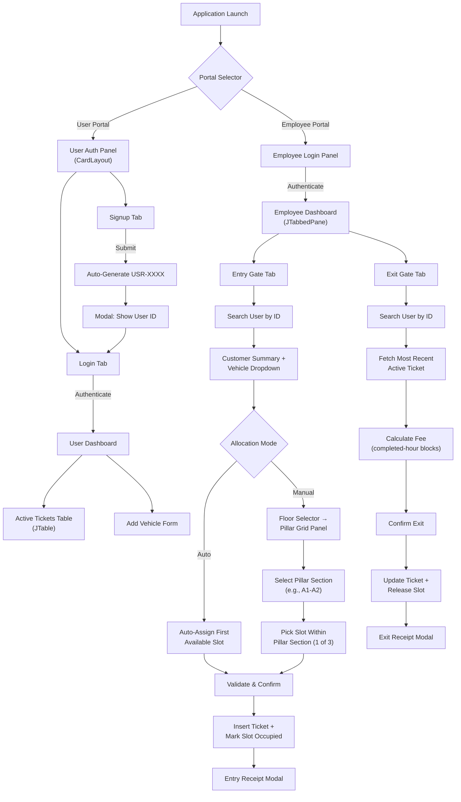
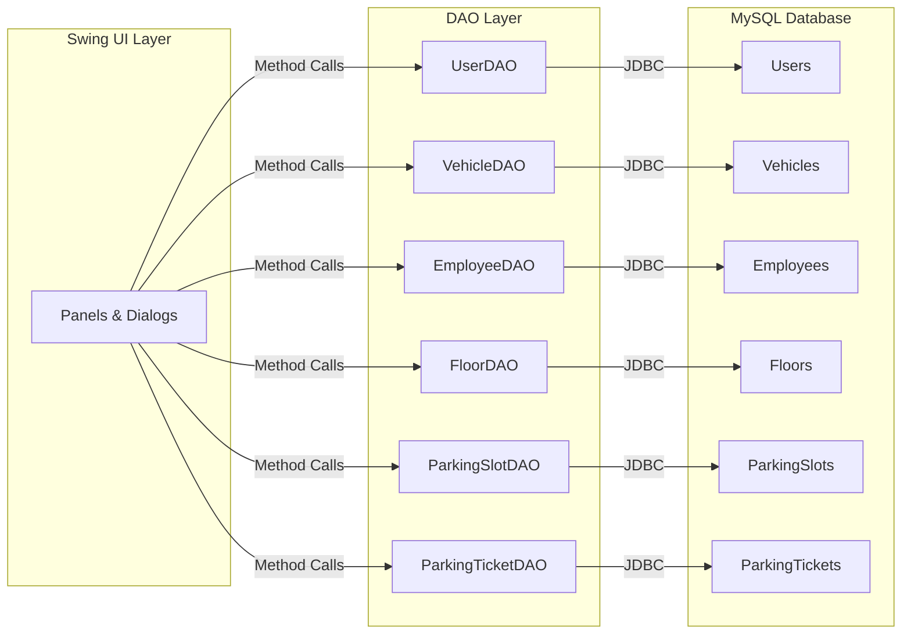

# 💡 IDEA.md — Smart Parking Management System

## System Identity

| Attribute             | Value                                        |
|-----------------------|----------------------------------------------|
| **Project Name**      | Smart Parking Management System              |
| **Platform**          | Desktop (Java Swing)                         |
| **Architecture**      | Monolithic · DAO Pattern · JDBC · MySQL      |
| **Target Audience**   | University Capstone Evaluation / Live Demo   |
| **Version**           | 1.0.0-CAPSTONE                               |

---

## 1. Design Philosophy

### 1.1 Core Value Proposition

> **"Zero-hardware parking operations — fast manual lookup, visual grid allocation, and live-demo readiness in a single JAR."**

This system deliberately eliminates all external hardware dependencies (barcode scanners, QR readers, boom barriers, IoT sensors, webcams). Every operation is driven through **keyboard-first manual ID lookup** and a **visual slot-grid selector**, making it ideal for:

- Live university capstone presentations on any laptop.
- Evaluation environments with no network/hardware setup time.
- Demonstrating full-stack OOP, relational DB design, and Swing UI proficiency.

### 1.2 Guiding Principles

| # | Principle                        | Rationale                                                                 |
|---|----------------------------------|---------------------------------------------------------------------------|
| 1 | **Presentation-First UX**       | Every workflow completes in ≤ 3 clicks so evaluators see results fast.    |
| 2 | **Relational Integrity Always** | InnoDB foreign keys enforce every relationship — no orphan records ever.  |
| 3 | **No Magic, No Frameworks**     | Pure Java SE + JDBC + Swing. No Spring, Hibernate, or Maven plugins.     |
| 4 | **Seed-and-Go**                 | Run `schema.sql` once and the app is fully testable with realistic data.  |
| 5 | **Separation of Concerns**      | Model → DAO → UI layering; no SQL in Swing classes, no UI in DAOs.       |

---

## 2. High-Level System Overview

### 2.1 Actors

| Actor        | Description                                                             |
|--------------|-------------------------------------------------------------------------|
| **User**     | A parking customer (student/visitor) who registers, logs in, and views active tickets. |
| **Employee** | A parking attendant or manager who processes vehicle entries and exits.  |

### 2.2 Capability Matrix

| Capability                  | User Portal | Employee Portal |
|-----------------------------|:-----------:|:---------------:|
| Self-Signup (auto-gen ID)   | ✅          | —               |
| Login                       | ✅          | ✅              |
| View Active Tickets         | ✅          | ✅ (any user)   |
| Register Additional Vehicle | ✅          | —               |
| Entry Gate — Search & Allot | —           | ✅              |
| Exit Gate — Bill & Release  | —           | ✅              |
| Manual Slot Grid Selector   | —           | ✅              |
| Auto-Assign Slot            | —           | ✅              |

---

## 3. UI Architecture Flowchart



---

## 4. Screen Inventory

| #  | Screen / Panel               | Swing Root       | Key Components                                     |
|----|------------------------------|------------------|-----------------------------------------------------|
| 1  | Portal Selector              | `JFrame`         | Two large `JButton` cards (User / Employee)         |
| 2  | User Signup                  | `JPanel`         | `JTextField` × 3, `JComboBox` (vehicle type), `JButton` |
| 3  | User Login                   | `JPanel`         | `JTextField`, `JPasswordField`, `JButton`           |
| 4  | User ID Confirmation Modal   | `JOptionPane`    | Generated ID displayed with `<html><b>` formatting  |
| 5  | User Dashboard               | `JPanel`         | `JTable` (active tickets), `JButton` (Add Vehicle)  |
| 6  | Add Vehicle Dialog            | `JDialog`        | `JTextField` (plate), `JComboBox` (2W/4W), `JButton`|
| 7  | Employee Login               | `JPanel`         | `JTextField`, `JPasswordField`, `JButton`           |
| 8  | Employee Dashboard           | `JTabbedPane`    | Two tabs: Entry Gate, Exit Gate                     |
| 9  | Entry Gate Panel             | `JPanel`         | Search field, summary label, vehicle dropdown, mode toggle, grid panel |
| 10 | Slot Grid Panel              | `JPanel` (Grid)  | Floor dropdown, pillar-section buttons (color-coded) |
| 11 | Entry Receipt Modal          | `JDialog`        | Formatted receipt with entry time, slot, vehicle     |
| 12 | Exit Gate Panel              | `JPanel`         | Search field, ticket summary, fee breakdown, confirm |
| 13 | Exit Receipt Modal           | `JDialog`        | Itemized bill with duration, rate, total fee         |

---

## 5. Data Flow Summary



---

## 6. Parking Grid Conceptual Model

Each floor is organized into a grid of **rows** (A–D) and **columns** (1–8). Adjacent column pairs form a **pillar section** (e.g., A1-A2). Each pillar section houses exactly **3 parking slots**.

```
Floor 1 — Row A:
┌─────────────┐  ┌─────────────┐  ┌─────────────┐  ┌─────────────┐
│  A1-A2      │  │  A3-A4      │  │  A5-A6      │  │  A7-A8      │
│  [S1][S2][S3]│  │  [S4][S5][S6]│  │  [S7][S8][S9]│  │ [S10][S11][S12]│
└─────────────┘  └─────────────┘  └─────────────┘  └─────────────┘

(Repeated for Rows B, C, D → 4 rows × 4 pillar sections × 3 slots = 48 slots/floor)
```

---

## 7. Fee Engine Logic (Conceptual)

| Duration       | Completed Hours | 2W Fee (₹40/hr) | 4W Fee (₹80/hr) |
|---------------|:--------------:|:----------------:|:----------------:|
| 0–59 min       | 0              | ₹0               | ₹0               |
| 60 min         | 1              | ₹40              | ₹80              |
| 61–119 min     | 2              | ₹80              | ₹160             |
| 120 min        | 2              | ₹80              | ₹160             |
| 121–179 min    | 3              | ₹120             | ₹240             |

> **Formula:** `completedHours = ceil(totalMinutes / 60)` when `totalMinutes >= 60`, else `0`.
> 
> **Correction per spec:** 59 min = ₹0; 61 min = 2 blocks. This means billing uses: `completedHours = floor(totalMinutes / 60)` when `totalMinutes < 60` → 0, otherwise `floor(totalMinutes / 60) + (totalMinutes % 60 > 0 ? 1 : 0)` — but the 59-min = ₹0 rule means the first block only completes at exactly 60 min. Reconciled: `completedHours = floor(totalMinutes / 60)` treats partial trailing hours as a new completed block only when `totalMinutes > 60`. See PRD for exact algorithm.

---

## 8. Non-Goals (Explicitly Out of Scope)

| Feature                          | Reason Excluded                              |
|----------------------------------|----------------------------------------------|
| QR Code / Barcode Scanning       | Hardware dependency — violates core premise  |
| Online/Cloud Deployment          | Desktop-only capstone scope                  |
| Payment Gateway Integration      | Fee is calculated; payment assumed settled    |
| Role-Based Access Control (RBAC) | Single employee role level is sufficient      |
| Reporting / Analytics Dashboard  | Out of MVP capstone scope                    |
| Multi-language / i18n            | English-only for demo                        |
| Password Hashing / Encryption    | Academic project; plaintext acceptable        |

---

*Document Version: 1.0.0 · Last Updated: 2026-10-22 · Author: Architecture Agent*
