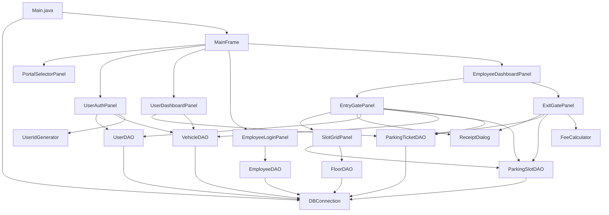

# 🏗 TECHNICAL_CONTEXT.md — Architecture & Implementation Blueprint

## Smart Parking Management System

> **Purpose:** This document provides exhaustive technical specifications for downstream coding agents or developers to implement the full application. It covers package structure, JDBC patterns, DAO contracts, model classes, Swing layout architecture, and inter-component wiring.

---

## Table of Contents

1. [Package Structure](#1-package-structure)
2. [Configuration Layer](#2-configuration-layer---comparkingconfig)
3. [Model Layer](#3-model-layer---comparkingmodel)
4. [DAO Layer](#4-dao-layer---comparkingdao)
5. [UI Layer](#5-ui-layer---comparkingui)
6. [Application Entry Point](#6-application-entry-point)
7. [Transaction Management Patterns](#7-transaction-management-patterns)
8. [Fee Calculation Utility](#8-fee-calculation-utility)
9. [User ID Generation Utility](#9-user-id-generation-utility)
10. [Error Handling Strategy](#10-error-handling-strategy)
11. [Build & Run Instructions](#11-build--run-instructions)
12. [Dependency Matrix](#12-dependency-matrix)

---

## 1. Package Structure

```
src/
└── com/
    └── parking/
        ├── config/
        │   └── DBConnection.java          # Singleton JDBC connection manager
        ├── model/
        │   ├── User.java                  # User POJO
        │   ├── Vehicle.java               # Vehicle POJO
        │   ├── Employee.java              # Employee POJO
        │   ├── Floor.java                 # Floor POJO
        │   ├── ParkingSlot.java           # ParkingSlot POJO
        │   └── ParkingTicket.java         # ParkingTicket POJO
        ├── dao/
        │   ├── UserDAO.java               # CRUD for Users table
        │   ├── VehicleDAO.java            # CRUD for Vehicles table
        │   ├── EmployeeDAO.java           # Auth queries for Employees
        │   ├── FloorDAO.java              # Read operations for Floors
        │   ├── ParkingSlotDAO.java         # Slot queries and status updates
        │   └── ParkingTicketDAO.java       # Ticket lifecycle management
        ├── ui/
        │   ├── MainFrame.java             # Root JFrame + CardLayout controller
        │   ├── PortalSelectorPanel.java   # Landing screen with portal buttons
        │   ├── UserAuthPanel.java         # JTabbedPane: Signup + Login tabs
        │   ├── UserDashboardPanel.java    # Active tickets table + Add Vehicle
        │   ├── EmployeeLoginPanel.java    # Employee authentication form
        │   ├── EmployeeDashboardPanel.java# JTabbedPane: Entry + Exit tabs
        │   ├── EntryGatePanel.java        # Full entry workflow panel
        │   ├── ExitGatePanel.java         # Full exit workflow panel
        │   ├── SlotGridPanel.java         # Visual pillar-section grid selector
        │   └── ReceiptDialog.java         # Reusable receipt modal dialog
        ├── util/
        │   ├── FeeCalculator.java         # Billing logic utility
        │   └── UserIdGenerator.java       # USR-XXXX generation utility
        └── Main.java                      # Application entry point
```

---

## 2. Configuration Layer — `com.parking.config`

### 2.1 DBConnection.java — Singleton JDBC Connection Manager

**Responsibility:** Provide a single shared `java.sql.Connection` instance to all DAO classes.

#### Design Contract

```
Class: DBConnection
Pattern: Singleton (lazy initialization)

Constants:
    - URL:      "jdbc:mysql://localhost:3306/smart_parking?useSSL=false&allowPublicKeyRetrieval=true&serverTimezone=UTC"
    - USER:     "root"
    - PASSWORD: "" (or configurable)
    - DRIVER:   "com.mysql.cj.jdbc.Driver"

Methods:
    + static Connection getConnection()
        - Loads JDBC driver via Class.forName(DRIVER) on first call
        - Creates connection via DriverManager.getConnection(URL, USER, PASSWORD)
        - Returns the same connection instance on subsequent calls
        - If connection is closed or null, re-creates it
        - Throws RuntimeException wrapping SQLException on failure

    + static void closeConnection()
        - Closes the connection if it is open
        - Sets internal reference to null
```

#### JDBC Driver Dependency

| Library                        | File                          | Download Source                  |
|-------------------------------|-------------------------------|----------------------------------|
| MySQL Connector/J 8.x         | `mysql-connector-j-8.x.x.jar`| Maven Central or MySQL Downloads |

> [!IMPORTANT]
> The connector JAR must be on the classpath at compile time and runtime. When running from command line: `java -cp ".:lib/mysql-connector-j-8.x.x.jar" com.parking.Main`

---

## 3. Model Layer — `com.parking.model`

All model classes are plain Java POJOs with private fields, a no-arg constructor, a parameterized constructor, and standard getters/setters.

### 3.1 User.java

| Field       | Type     | Maps To              |
|-------------|----------|----------------------|
| `userId`    | `String` | `Users.user_id`      |
| `name`      | `String` | `Users.name`         |
| `password`  | `String` | `Users.password`     |

### 3.2 Vehicle.java

| Field           | Type     | Maps To                    |
|-----------------|----------|----------------------------|
| `vehicleNumber` | `String` | `Vehicles.vehicle_number`  |
| `userId`        | `String` | `Vehicles.user_id`         |
| `type`          | `String` | `Vehicles.type`            |

### 3.3 Employee.java

| Field        | Type     | Maps To                    |
|-------------|----------|----------------------------|
| `employeeId`| `int`    | `Employees.employee_id`    |
| `username`  | `String` | `Employees.username`       |
| `password`  | `String` | `Employees.password`       |
| `role`      | `String` | `Employees.role`           |

### 3.4 Floor.java

| Field         | Type     | Maps To                |
|--------------|----------|------------------------|
| `floorId`    | `int`    | `Floors.floor_id`      |
| `floorNumber`| `String` | `Floors.floor_number`  |

### 3.5 ParkingSlot.java

| Field           | Type      | Maps To                        |
|-----------------|-----------|--------------------------------|
| `slotId`        | `int`     | `ParkingSlots.slot_id`         |
| `floorId`       | `int`     | `ParkingSlots.floor_id`        |
| `pillarSection` | `String`  | `ParkingSlots.pillar_section`  |
| `slotType`      | `String`  | `ParkingSlots.slot_type`       |
| `isOccupied`    | `boolean` | `ParkingSlots.is_occupied`     |

### 3.6 ParkingTicket.java

| Field           | Type              | Maps To                            |
|-----------------|-------------------|------------------------------------|
| `ticketId`      | `int`             | `ParkingTickets.ticket_id`         |
| `vehicleNumber` | `String`          | `ParkingTickets.vehicle_number`    |
| `slotId`        | `int`             | `ParkingTickets.slot_id`           |
| `employeeId`    | `int`             | `ParkingTickets.employee_id`       |
| `entryTime`     | `LocalDateTime`   | `ParkingTickets.entry_time`        |
| `exitTime`      | `LocalDateTime`   | `ParkingTickets.exit_time`         |
| `totalFee`      | `BigDecimal`      | `ParkingTickets.total_fee`         |

> [!NOTE]
> Use `java.time.LocalDateTime` for timestamps and `java.math.BigDecimal` for monetary values. Convert between JDBC `Timestamp` and `LocalDateTime` using `Timestamp.valueOf()` and `timestamp.toLocalDateTime()`.

---

## 4. DAO Layer — `com.parking.dao`

All DAO classes follow these conventions:
- Obtain `Connection` from `DBConnection.getConnection()`.
- Use `PreparedStatement` exclusively (no `Statement` or string concatenation).
- Return model objects or `List<Model>` from query methods.
- Return `boolean` or `int` (affected rows) from mutation methods.
- Do NOT catch `SQLException` internally for transaction-participating methods — let them propagate so the caller can rollback.

---

### 4.1 UserDAO.java

```
Method Signatures:

+ boolean insertUser(User user)
    SQL: INSERT INTO Users (user_id, name, password) VALUES (?, ?, ?)
    Returns: true on success

+ User getUserById(String userId)
    SQL: SELECT * FROM Users WHERE user_id = ?
    Returns: User object or null if not found

+ User authenticate(String userId, String password)
    SQL: SELECT * FROM Users WHERE user_id = ? AND password = ?
    Returns: User object or null if credentials invalid

+ boolean userIdExists(String userId)
    SQL: SELECT COUNT(*) FROM Users WHERE user_id = ?
    Returns: true if count > 0
```

---

### 4.2 VehicleDAO.java

```
Method Signatures:

+ boolean insertVehicle(Vehicle vehicle)
    SQL: INSERT INTO Vehicles (vehicle_number, user_id, type) VALUES (?, ?, ?)
    Returns: true on success

+ List<Vehicle> getVehiclesByUserId(String userId)
    SQL: SELECT * FROM Vehicles WHERE user_id = ?
    Returns: List of Vehicle objects (may be empty)

+ boolean vehicleExists(String vehicleNumber)
    SQL: SELECT COUNT(*) FROM Vehicles WHERE vehicle_number = ?
    Returns: true if count > 0

+ Vehicle getVehicleByNumber(String vehicleNumber)
    SQL: SELECT * FROM Vehicles WHERE vehicle_number = ?
    Returns: Vehicle object or null
```

---

### 4.3 EmployeeDAO.java

```
Method Signatures:

+ Employee authenticate(String username, String password)
    SQL: SELECT * FROM Employees WHERE username = ? AND password = ?
    Returns: Employee object or null if credentials invalid
```

---

### 4.4 FloorDAO.java

```
Method Signatures:

+ List<Floor> getAllFloors()
    SQL: SELECT * FROM Floors ORDER BY floor_id
    Returns: List of Floor objects
```

---

### 4.5 ParkingSlotDAO.java

```
Method Signatures:

+ ParkingSlot findFirstAvailableSlot(String slotType)
    SQL: SELECT * FROM ParkingSlots
         WHERE slot_type = ? AND is_occupied = FALSE
         ORDER BY floor_id ASC, slot_id ASC
         LIMIT 1
    Returns: ParkingSlot object or null if none available

+ List<ParkingSlot> getSlotsByFloorAndPillar(int floorId, String pillarSection, String slotType)
    SQL: SELECT * FROM ParkingSlots
         WHERE floor_id = ? AND pillar_section = ? AND slot_type = ? AND is_occupied = FALSE
    Returns: List of available slots in that pillar section

+ int countAvailableSlots(int floorId, String pillarSection, String slotType)
    SQL: SELECT COUNT(*) FROM ParkingSlots
         WHERE floor_id = ? AND pillar_section = ? AND slot_type = ? AND is_occupied = FALSE
    Returns: count of available slots

+ boolean updateSlotOccupancy(int slotId, boolean isOccupied)
    SQL: UPDATE ParkingSlots SET is_occupied = ? WHERE slot_id = ?
    Returns: true if 1 row affected

+ ParkingSlot getSlotById(int slotId)
    SQL: SELECT * FROM ParkingSlots WHERE slot_id = ?
    Returns: ParkingSlot object or null

+ List<String> getPillarSectionsByFloor(int floorId)
    SQL: SELECT DISTINCT pillar_section FROM ParkingSlots
         WHERE floor_id = ?
         ORDER BY pillar_section
    Returns: List of pillar section strings (e.g., ["A1-A2", "A3-A4", ...])
```

---

### 4.6 ParkingTicketDAO.java

```
Method Signatures:

+ int insertTicket(ParkingTicket ticket)
    SQL: INSERT INTO ParkingTickets (vehicle_number, slot_id, employee_id, entry_time)
         VALUES (?, ?, ?, NOW())
    Returns: Generated ticket_id (use Statement.RETURN_GENERATED_KEYS)

+ ParkingTicket getActiveTicketByVehicle(String vehicleNumber)
    SQL: SELECT * FROM ParkingTickets
         WHERE vehicle_number = ? AND exit_time IS NULL
         ORDER BY entry_time DESC LIMIT 1
    Returns: ParkingTicket or null

+ ParkingTicket getMostRecentActiveTicketByUserId(String userId)
    SQL: SELECT pt.* FROM ParkingTickets pt
         JOIN Vehicles v ON pt.vehicle_number = v.vehicle_number
         WHERE v.user_id = ? AND pt.exit_time IS NULL
         ORDER BY pt.entry_time DESC
         LIMIT 1
    Returns: ParkingTicket or null

+ boolean updateTicketExit(int ticketId, BigDecimal totalFee)
    SQL: UPDATE ParkingTickets
         SET exit_time = NOW(), total_fee = ?
         WHERE ticket_id = ?
    Returns: true if 1 row affected

+ List<ParkingTicket> getActiveTicketsByUserId(String userId)
    SQL: SELECT pt.* FROM ParkingTickets pt
         JOIN Vehicles v ON pt.vehicle_number = v.vehicle_number
         WHERE v.user_id = ? AND pt.exit_time IS NULL
         ORDER BY pt.entry_time DESC
    Returns: List of active tickets for dashboard display

+ boolean hasActiveTicket(String vehicleNumber)
    SQL: SELECT COUNT(*) FROM ParkingTickets
         WHERE vehicle_number = ? AND exit_time IS NULL
    Returns: true if count > 0
```

---

## 5. UI Layer — `com.parking.ui`

### 5.1 MainFrame.java — Root Frame & Navigation Controller

```
Class: MainFrame extends JFrame

Layout: CardLayout as the content pane's layout manager

Card Registry:
    "PORTAL_SELECTOR"      → PortalSelectorPanel
    "USER_AUTH"             → UserAuthPanel
    "USER_DASHBOARD"       → UserDashboardPanel
    "EMPLOYEE_LOGIN"       → EmployeeLoginPanel
    "EMPLOYEE_DASHBOARD"   → EmployeeDashboardPanel

Constructor:
    - Set title: "Smart Parking Management System"
    - Set size: 1000 × 700
    - Set defaultCloseOperation: EXIT_ON_CLOSE
    - Set locationRelativeTo: null (centered)
    - Initialize CardLayout and all panels
    - Show "PORTAL_SELECTOR" as default card

Navigation Methods:
    + void showCard(String cardName)
        - Calls CardLayout.show(contentPane, cardName)
    + void navigateToUserDashboard(User loggedInUser)
        - Passes user context to UserDashboardPanel, then shows it
    + void navigateToEmployeeDashboard(Employee loggedInEmployee)
        - Passes employee context to EmployeeDashboardPanel, then shows it
    + void logout()
        - Clears any session state, shows "PORTAL_SELECTOR"
```

---

### 5.2 PortalSelectorPanel.java

```
Class: PortalSelectorPanel extends JPanel

Layout: GridBagLayout (centered)

Components:
    - JLabel: Title "Smart Parking Management System" (large font, bold, <html> formatted)
    - JButton: "🚗 User Portal"     → triggers mainFrame.showCard("USER_AUTH")
    - JButton: "👔 Employee Portal"  → triggers mainFrame.showCard("EMPLOYEE_LOGIN")

Styling:
    - Buttons should be large (preferred size ~250×60)
    - Use Font size 18+ for title, 14+ for buttons
```

---

### 5.3 UserAuthPanel.java

```
Class: UserAuthPanel extends JPanel

Layout: BorderLayout with JTabbedPane as CENTER

Tabs:
    Tab 1 - "Signup":
        - Components: Name (JTextField), Password (JPasswordField),
          Vehicle Number (JTextField), Vehicle Type (JComboBox: 2W/4W),
          Submit (JButton)
        - Action: Validate → Generate USR-XXXX → Transaction(insert User + insert Vehicle)
          → Show confirmation modal with generated ID
        - On success: Optionally switch to Login tab

    Tab 2 - "Login":
        - Components: User ID (JTextField), Password (JPasswordField),
          Login (JButton)
        - Action: Validate → UserDAO.authenticate() → navigate to UserDashboardPanel

    Footer: "← Back" button → mainFrame.showCard("PORTAL_SELECTOR")
```

---

### 5.4 UserDashboardPanel.java

```
Class: UserDashboardPanel extends JPanel

State:
    - User currentUser (set before panel is shown)

Layout: BorderLayout
    NORTH: Header label "Welcome, {name} ({userId})" + "Logout" button
    CENTER: JScrollPane wrapping JTable (active tickets)
    SOUTH: "+ Add Vehicle" button

JTable Columns: [Ticket ID, Vehicle Number, Vehicle Type, Floor, Pillar Section, Entry Time]

Data Loading:
    - Called each time the panel is shown (override addNotify or use a refresh method)
    - Query joins ParkingTickets + Vehicles + ParkingSlots + Floors
    - Filter: user_id = currentUser.userId AND exit_time IS NULL

Add Vehicle Dialog:
    - JDialog with Vehicle Number (JTextField) + Vehicle Type (JComboBox) + "Add" JButton
    - Validates uniqueness via VehicleDAO.vehicleExists()
    - Inserts via VehicleDAO.insertVehicle()
```

---

### 5.5 EmployeeLoginPanel.java

```
Class: EmployeeLoginPanel extends JPanel

Layout: GridBagLayout (centered form)

Components:
    - JLabel: "Employee Login"
    - JTextField: Username
    - JPasswordField: Password
    - JButton: "Login"
    - JButton: "← Back" → PORTAL_SELECTOR

Action:
    - EmployeeDAO.authenticate(username, password)
    - On success: mainFrame.navigateToEmployeeDashboard(employee)
    - On failure: JOptionPane error dialog
```

---

### 5.6 EmployeeDashboardPanel.java

```
Class: EmployeeDashboardPanel extends JPanel

State:
    - Employee currentEmployee

Layout: BorderLayout
    NORTH: Header "Employee Dashboard — {username} ({role})" + "Logout" button
    CENTER: JTabbedPane
        Tab 1: EntryGatePanel
        Tab 2: ExitGatePanel

Methods:
    + void setEmployee(Employee emp)
        - Passes employee reference to both gate panels
```

---

### 5.7 EntryGatePanel.java

```
Class: EntryGatePanel extends JPanel

State:
    - Employee currentEmployee
    - User foundUser
    - List<Vehicle> userVehicles
    - ParkingSlot selectedSlot

Layout: BoxLayout(Y_AXIS) or GridBagLayout — vertically stacked sections

Section 1 — User Search:
    - JTextField (User ID) + JButton ("Search")
    - On search: UserDAO.getUserById() → populate Section 2

Section 2 — Customer Summary (initially hidden):
    - JLabel: "Customer: {name} ({userId})"
    - JComboBox: Vehicles (populated from VehicleDAO.getVehiclesByUserId)
      Display format: "KA-01-AB-1234 (4W)"

Section 3 — Allocation Mode:
    - ButtonGroup with JRadioButton: "Auto-Assign" (default), "Manual-Assign"
    - When Manual selected: show SlotGridPanel (Section 4)

Section 4 — Slot Grid (conditional — Manual mode only):
    - Embedded SlotGridPanel instance
    - Communicates selected slot back to EntryGatePanel

Section 5 — Confirm Button:
    - JButton: "Allocate Slot & Generate Ticket"
    - Action:
        1. Determine slot (auto or manual)
        2. Validate no active ticket for this vehicle
        3. Begin transaction
        4. Insert ticket → Mark slot occupied
        5. Commit → Show ReceiptDialog (entry)
        6. On error → Rollback → Show error dialog
    - After success: Reset all sections for next operation
```

---

### 5.8 ExitGatePanel.java

```
Class: ExitGatePanel extends JPanel

State:
    - Employee currentEmployee
    - ParkingTicket activeTicket
    - Vehicle ticketVehicle
    - ParkingSlot ticketSlot
    - BigDecimal calculatedFee

Layout: BoxLayout(Y_AXIS) or GridBagLayout

Section 1 — User Search:
    - JTextField (User ID) + JButton ("Search")
    - On search: ParkingTicketDAO.getMostRecentActiveTicketByUserId()
      → If found, populate Section 2
      → If not found, show info dialog

Section 2 — Ticket Summary (initially hidden):
    - Labels showing: Ticket ID, Vehicle Number, Vehicle Type, Floor, Pillar,
      Entry Time, Current Time, Duration, Completed Hours, Rate, Total Fee
    - Fee auto-calculated using FeeCalculator utility

Section 3 — Confirm Button:
    - JButton: "Confirm Exit & Payment"
    - Action:
        1. Begin transaction
        2. Update ticket (exit_time, total_fee)
        3. Update slot (is_occupied = FALSE)
        4. Commit → Show ReceiptDialog (exit)
        5. On error → Rollback → Show error dialog
    - After success: Reset all sections
```

---

### 5.9 SlotGridPanel.java

```
Class: SlotGridPanel extends JPanel

Purpose: Visual grid of pillar-section buttons for manual slot selection

State:
    - int selectedFloorId
    - String selectedVehicleType
    - ParkingSlot selectedSlot (output)

Layout:
    NORTH: JComboBox (Floor selector — populated from FloorDAO.getAllFloors())
    CENTER: JPanel with GridLayout(4, 4, 8, 8) — the 4×4 pillar grid

Grid Buttons:
    - 16 JButtons labeled: A1-A2, A3-A4, ..., D7-D8
    - On floor change or refresh:
        For each pillar section:
            count = ParkingSlotDAO.countAvailableSlots(floorId, pillarSection, vehicleType)
            if count > 0:
                button.setBackground(Color.GREEN)
                button.setEnabled(true)
                button.setText("<html><b>" + section + "</b><br/>" + count + " free</html>")
            else:
                button.setBackground(Color.RED)
                button.setEnabled(false)
                button.setText("<html><b>" + section + "</b><br/>FULL</html>")

    - On button click:
        slots = ParkingSlotDAO.getSlotsByFloorAndPillar(floorId, section, vehicleType)
        selectedSlot = slots.get(0)  // first available
        // Highlight selected button, update state

Public Interface:
    + void refreshGrid(int floorId, String vehicleType)
    + ParkingSlot getSelectedSlot()
    + void addSlotSelectionListener(ActionListener listener)
```

---

### 5.10 ReceiptDialog.java

```
Class: ReceiptDialog extends JDialog

Purpose: Reusable modal dialog for entry and exit receipts

Constructor:
    ReceiptDialog(JFrame parent, String title, Map<String, String> receiptFields)

Layout: BorderLayout
    NORTH: Title label (bold, large)
    CENTER: JPanel with GridLayout(N, 2) — label-value pairs from receiptFields map
    SOUTH: "OK" button → dispose()

Usage (Entry Receipt):
    Map<String, String> fields = new LinkedHashMap<>();
    fields.put("Ticket ID", "1042");
    fields.put("Customer", "Aryan Kumar");
    fields.put("Vehicle", "KA-01-AB-1234 (4W)");
    fields.put("Floor", "Floor 1");
    fields.put("Pillar", "A3-A4");
    fields.put("Slot ID", "15");
    fields.put("Entry Time", "2026-10-22 09:15:00");
    fields.put("Employee", "attendant");
    new ReceiptDialog(mainFrame, "Parking Entry Receipt", fields).setVisible(true);

Usage (Exit Receipt):
    // Same pattern with exit-specific fields including duration, fee, etc.
```

---

## 6. Application Entry Point

### Main.java

```
Class: Main (in package com.parking)

public static void main(String[] args):
    1. Set Look and Feel:
        UIManager.setLookAndFeel(UIManager.getSystemLookAndFeelClassName())
        // Or: UIManager.setLookAndFeel("javax.swing.plaf.nimbus.NimbusLookAndFeel")

    2. Test DB Connection:
        try { DBConnection.getConnection(); }
        catch (Exception e) {
            JOptionPane.showMessageDialog(null,
                "Database connection failed!\n" + e.getMessage(),
                "Fatal Error", JOptionPane.ERROR_MESSAGE);
            System.exit(1);
        }

    3. Launch UI on EDT:
        SwingUtilities.invokeLater(() -> {
            MainFrame frame = new MainFrame();
            frame.setVisible(true);
        });
```

> [!IMPORTANT]
> All Swing operations MUST be performed on the Event Dispatch Thread (EDT) via `SwingUtilities.invokeLater()`. Database calls within action listeners should ideally be wrapped in `SwingWorker` for responsiveness, but for capstone demo simplicity, synchronous calls on EDT are acceptable given the local MySQL latency.

---

## 7. Transaction Management Patterns

### 7.1 Entry Gate Transaction

```
Pseudocode:

Connection conn = DBConnection.getConnection();
conn.setAutoCommit(false);
try {
    // 1. Re-verify slot is still available
    ParkingSlot slot = parkingSlotDAO.getSlotById(selectedSlotId);
    if (slot == null || slot.isOccupied()) {
        throw new Exception("Slot no longer available");
    }

    // 2. Verify vehicle has no active ticket
    if (parkingTicketDAO.hasActiveTicket(vehicleNumber)) {
        throw new Exception("Vehicle already has active session");
    }

    // 3. Insert ticket
    ParkingTicket ticket = new ParkingTicket();
    ticket.setVehicleNumber(vehicleNumber);
    ticket.setSlotId(selectedSlotId);
    ticket.setEmployeeId(employee.getEmployeeId());
    int ticketId = parkingTicketDAO.insertTicket(ticket);

    // 4. Mark slot as occupied
    parkingSlotDAO.updateSlotOccupancy(selectedSlotId, true);

    conn.commit();
    // Show receipt
} catch (Exception e) {
    conn.rollback();
    // Show error dialog
} finally {
    conn.setAutoCommit(true);
}
```

### 7.2 Exit Gate Transaction

```
Pseudocode:

Connection conn = DBConnection.getConnection();
conn.setAutoCommit(false);
try {
    // 1. Update ticket with exit time and fee
    parkingTicketDAO.updateTicketExit(ticketId, calculatedFee);

    // 2. Release the slot
    parkingSlotDAO.updateSlotOccupancy(slotId, false);

    conn.commit();
    // Show receipt
} catch (Exception e) {
    conn.rollback();
    // Show error dialog
} finally {
    conn.setAutoCommit(true);
}
```

### 7.3 User Signup Transaction

```
Pseudocode:

Connection conn = DBConnection.getConnection();
conn.setAutoCommit(false);
try {
    // 1. Generate unique user ID
    String userId = UserIdGenerator.generate(conn);  // checks for collisions

    // 2. Insert user
    User user = new User(userId, name, password);
    userDAO.insertUser(user);

    // 3. Insert initial vehicle
    Vehicle vehicle = new Vehicle(vehicleNumber, userId, vehicleType);
    vehicleDAO.insertVehicle(vehicle);

    conn.commit();
    // Show success modal with userId
} catch (Exception e) {
    conn.rollback();
    // Show error dialog
} finally {
    conn.setAutoCommit(true);
}
```

---

## 8. Fee Calculation Utility

### FeeCalculator.java

```
Class: FeeCalculator (in package com.parking.util)

Constants:
    + static final BigDecimal RATE_2W = new BigDecimal("40.00")
    + static final BigDecimal RATE_4W = new BigDecimal("80.00")

Methods:
    + static BigDecimal calculateFee(LocalDateTime entryTime, LocalDateTime exitTime, String vehicleType)
        1. long totalMinutes = ChronoUnit.MINUTES.between(entryTime, exitTime)
        2. if (totalMinutes < 60) return BigDecimal.ZERO
        3. long completedHours = (long) Math.ceil(totalMinutes / 60.0)
        4. BigDecimal rate = vehicleType.equals("2W") ? RATE_2W : RATE_4W
        5. return rate.multiply(BigDecimal.valueOf(completedHours))

    + static String formatDuration(LocalDateTime entryTime, LocalDateTime exitTime)
        - Returns human-readable string like "3 hrs 25 mins"

    + static long getCompletedHours(LocalDateTime entryTime, LocalDateTime exitTime)
        - Returns the completed-hour count (for display)
```

---

## 9. User ID Generation Utility

### UserIdGenerator.java

```
Class: UserIdGenerator (in package com.parking.util)

Methods:
    + static String generate(Connection conn) throws Exception
        1. Random random = new Random()
        2. for (int attempt = 0; attempt < 10; attempt++):
            a. int num = 1000 + random.nextInt(9000)  // range [1000, 9999]
            b. String id = "USR-" + num
            c. Check: SELECT COUNT(*) FROM Users WHERE user_id = id
            d. If count == 0, return id
        3. throw new Exception("Failed to generate unique User ID after 10 attempts")
```

---

## 10. Error Handling Strategy

### 10.1 Categories

| Error Type              | Handling                                                                 |
|------------------------|--------------------------------------------------------------------------|
| DB Connection Failure   | Fatal — `JOptionPane` error + `System.exit(1)` at startup               |
| SQL Exception (query)   | Catch in DAO caller → `JOptionPane` error dialog + log to `stderr`      |
| SQL Exception (txn)     | Rollback transaction → `JOptionPane` error dialog                       |
| Validation Failure      | `JOptionPane.WARNING_MESSAGE` dialog with specific message              |
| Not Found (query)       | `JOptionPane.INFORMATION_MESSAGE` with "not found" message              |

### 10.2 Standard Error Dialog Pattern

```
JOptionPane.showMessageDialog(
    parentComponent,       // the current panel or frame
    errorMessage,          // human-readable description
    "Error",               // dialog title
    JOptionPane.ERROR_MESSAGE
);
```

---

## 11. Build & Run Instructions

### 11.1 Prerequisites

| Requirement       | Version          |
|-------------------|------------------|
| JDK               | 8+ (recommend 17)|
| MySQL Server      | 8.0+             |
| MySQL Connector/J | 8.x              |

### 11.2 Database Setup

```bash
# 1. Start MySQL server
# 2. Execute schema script
mysql -u root -p < schema.sql
```

### 11.3 Project Directory Layout

```
Parking_mgmt/
├── IDEA.md
├── PRD.md
├── TECHNICAL_CONTEXT.md
├── schema.sql
├── lib/
│   └── mysql-connector-j-8.x.x.jar
└── src/
    └── com/
        └── parking/
            ├── Main.java
            ├── config/
            ├── model/
            ├── dao/
            ├── ui/
            └── util/
```

### 11.4 Compile & Run

```bash
# From project root:

# Compile (Windows)
javac -cp "lib\mysql-connector-j-8.x.x.jar" -d out src\com\parking\*.java src\com\parking\config\*.java src\com\parking\model\*.java src\com\parking\dao\*.java src\com\parking\ui\*.java src\com\parking\util\*.java

# Run (Windows)
java -cp "out;lib\mysql-connector-j-8.x.x.jar" com.parking.Main

# Compile (Linux/Mac)
javac -cp "lib/mysql-connector-j-8.x.x.jar" -d out src/com/parking/**/*.java

# Run (Linux/Mac)
java -cp "out:lib/mysql-connector-j-8.x.x.jar" com.parking.Main
```

---

## 12. Dependency Matrix

### 12.1 Class Dependency Graph



### 12.2 DAO-to-Table Mapping

| DAO Class          | Primary Table    | Joined Tables (read)                       |
|--------------------|------------------|---------------------------------------------|
| UserDAO            | Users            | —                                           |
| VehicleDAO         | Vehicles         | —                                           |
| EmployeeDAO        | Employees        | —                                           |
| FloorDAO           | Floors           | —                                           |
| ParkingSlotDAO     | ParkingSlots     | Floors (for display)                        |
| ParkingTicketDAO   | ParkingTickets   | Vehicles, ParkingSlots, Floors (for queries)|

---

*Document Version: 1.0.0 · Last Updated: 2026-10-22 · Author: Architecture Agent*
